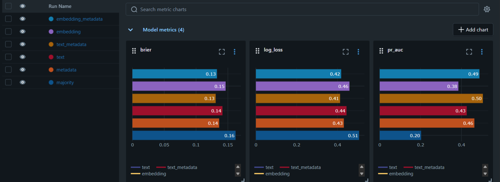

# motion-forecast

Predicts whether the Swiss Federal Council will propose to accept or reject a new Motion
or Postulat, from what is known when it is submitted: its text, its author's party, the
council and the department. A project to learn the MLflow model lifecycle.

Unofficial. Data: [Swiss Parliament open data web service](https://ws.parl.ch/doc/swagger-ui/index.html)
(ws.parl.ch). It needs an API key; set it as `PARL_API_KEY`.

## Run

```
uv sync
uv run python -m motion_forecast.data    # download ~20k Motionen and Postulate (~5 min)
uv run python -m motion_forecast.embed   # embed the texts with a language model (~1 h on a CPU)
uv run python -m motion_forecast.train   # model ladder in MLflow, registers the best (~5 min)
uv run mlflow ui                         # compare the runs at http://localhost:5000
uv run pytest
```

Then score a new Motion with the champion model, from its raw fields:

```python
import mlflow
import pandas as pd

mlflow.set_tracking_uri("sqlite:///mlflow.db")
model = mlflow.pyfunc.load_model("models:/motion-forecast@champion")
motion = {
    "type": "Postulat",
    "council": "NR",
    "party": "Mitte",
    "department": "EDI",
    "title": "Versorgung mit Medikamenten",
    "text": "Der Bundesrat wird beauftragt, in einem Bericht darzulegen, ...",
    "reason": "Lieferengpässe haben zugenommen.",
}
print(model.predict(pd.DataFrame([motion])))  # probability that it is accepted
```

Or serve the champion over HTTP. MLflow builds a fresh environment from the model's own
requirements, so the server runs without this project installed:

```
uv run mlflow models serve -m models:/motion-forecast@champion --env-manager uv -p 5001

curl http://127.0.0.1:5001/invocations -H "Content-Type: application/json" -d '{
  "dataframe_records": [{"type": "Motion", "council": "NR", "party": "SVP",
    "department": "EDI", "title": "Weniger Vorschriften",
    "text": "Der Bundesrat wird beauftragt, ...", "reason": "..."}]}'
# {"predictions": [0.074...]}
```

The alias is read at start-up: restart the server to pick up a new champion.

## Live forecast

```
uv run python -m motion_forecast.forecast
```

Forecasts every open Motion with the champion, scores earlier forecasts the Federal
Council has answered since, logs both to the `live-forecast` experiment in MLflow, and
commits and pushes the new forecasts to [forecasts.csv](forecasts.csv). Run it every few
weeks: the answer comes after a median of 62 days, so a month between runs misses only
the 2% answered faster.

## Fine-tune on a GPU

Fine-tuning the language model takes a GPU; a free Kaggle one will do. In a new Kaggle
notebook, turn on a GPU accelerator and internet access in the settings, and add your
`data/motions.parquet` as a dataset (Add Input > Upload). Then run:

```
!git clone https://github.com/jonastheiler/motion-forecast.git
%cd motion-forecast
!pip install -q -e .
!mkdir -p data && cp $(find /kaggle/input -name motions.parquet) data/
!python -m motion_forecast.finetune train
!cp data/finetuned.parquet /kaggle/working/
```

Download `finetuned.parquet` from the notebook's output into your own `data/` folder,
then log it as a stage of the ladder:

```
uv run python -m motion_forecast.finetune log
```

## Results so far

Trained on Motionen and Postulate answered 2007-2022, tested on those submitted since
2023 (3,116, of which 20% accepted). Lower log loss is better.

| Model | Log loss | Brier | PR-AUC | ROC-AUC |
|---|---|---|---|---|
| Majority (always 20%) | 0.506 | 0.162 | 0.20 | 0.50 |
| Metadata (party, council, type, department) | 0.431 | 0.136 | 0.46 | 0.76 |
| Text (TF-IDF) | 0.444 | 0.142 | 0.43 | 0.74 |
| Text + metadata | **0.413** | **0.131** | **0.50** | **0.79** |
| Embedding (multilingual-e5-small) | 0.459 | 0.147 | 0.39 | 0.72 |
| Embedding + metadata | 0.418 | 0.133 | 0.49 | 0.79 |



Who asks says more than what they ask: metadata alone beats the text alone. Committee
Motionen are accepted half the time, SVP Motionen 9%. The words still add information
on top.

A pretrained language model's sentence vectors do worse than plain word counts, alone
and with the metadata. The model was never trained for this task: its vector sums up
what a text is about, while the word counts keep every single term for the classifier
to weigh. Fine-tuning the language model on the labels is the next step to test.

## Key ideas

- **Split by time, train on what was known.** A model trained on 1 January only knows
  the answers given before that day (`train.periods`).
- **Accuracy misleads at 80/20.** "Always reject" is 80% accurate. Log loss and Brier
  score the probabilities, PR-AUC the rare accepts.
- **MLflow tracking.** One run per stage, with a nested run per hyperparameter setting.
  Each run logs its parameters, metrics, a digest of its data, a calibration and PR plot,
  and a per-party table.
- **Autologging has a cost.** `mlflow.sklearn.autolog()` made each run ~7x slower by
  scoring and plotting the training data, so the code logs only held-out scores.
- **A pyfunc carries its own preprocessing.** `MotionForecast` wraps the pipeline with
  `inputs()`, so callers send a Motion as it comes from the parliament. Its environment
  lists only the four packages it needs; by default MLflow copied the whole lock file.
- **Registry: every version is kept, one is champion.** Each training registers the
  stage that wins on validation. It takes the `champion` alias only if it beats the
  current champion on the test set, so callers loading `@champion` never get a worse one.
- **Serving needs no server code.** `mlflow models serve` turns the pyfunc into an HTTP
  API that checks each request against the model's schema. `tests/test_serve.py` checks
  that contract in-process, without starting a server.
- **Forecasts you can check.** `forecasts.csv` is only ever appended to, and git dates
  each forecast before its answer. The live log loss is logged next to the champion's
  test log loss: when it climbs well above, the model has gone stale.

## Status

- [x] M0 setup, M1 data
- [x] M2 baselines and experiment tracking with MLflow
- [x] M3a sentence embeddings as features
- [ ] M3b a fine-tuned transformer (needs a GPU)
- [x] M4 model registry and pyfunc
- [x] M5 serving
- [x] M6 live forecast and monitoring
